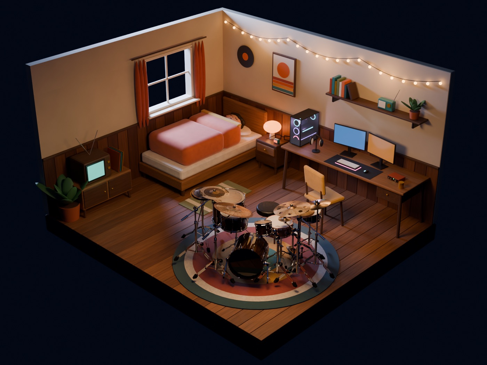
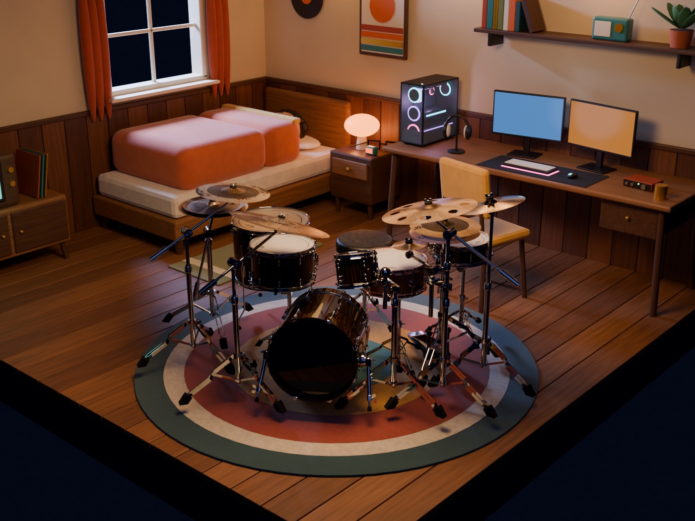

# alexgosleep — Alex Zhao's Portfolio

Personal site for **Zhao Lixiuqi (Alex)**: computer engineer, robotics tinkerer, and drummer.  
Live at [alexgosleep.com](https://alexgosleep.com).



## Two ways in

| Path | What you get |
|------|----------------|
| **My Room** (`/diorama`) | Interactive 3D bedroom — click the PC, drums, shelf, phone, or Alex. Noise wakes him up. |
| **My Portfolio** (`/home` → about / projects / contacts) | Fast plain site: résumé, projects, music, contact info. |



## What's on the site

- **Landing** — choose the room or the plain portfolio
- **Diorama** — Blender-built room + drum kit (GLB), React Three Fiber scene, hotspots, sound, wake meter
- **About** — education (NUS CEG + Machine Intelligence MSc) and robotics experience (Avetics, Hikvision, Continental, TLab IBVS)
- **Projects** — engineering (Autoboat, AR Laser Tag, RTOS car, this site) and music bands, with image galleries
- **Contacts** — email, socials, WeChat QR; like button is session-only (resets on reload)

## Tech stack

- **Next.js 15** (Pages Router) + React 19 + TypeScript
- **React Three Fiber** / Drei / Three.js for the diorama
- **Blender** pipeline under `blender/` (room bake, drum kit export, previews)
- **Swiper** for project/band image carousels
- Deployed on **Vercel**

## Local development

```bash
npm install
npm run dev          # turbopack
# or
npm run dev:classic
```

Open [http://localhost:3000](http://localhost:3000).

```bash
npm run build && npm start   # production build
npm run lint
```

## Project layout

| Path | Role |
|------|------|
| `src/pages/` | Routes (`index`, `diorama`, `home`, `about`, `projects`, `contacts`, …) |
| `src/diorama/` | 3D scene, HUD, hotspots, sounds |
| `src/content/` | Projects, bands, skills data |
| `public/models/` | `room.glb`, `drumkit.glb`, `alex.glb` |
| `blender/` | Scripts and assets that build/export the room |

Content for the projects page lives in `src/content/projects.ts`. Hotspot card copy is in `src/diorama/hotspots.ts`.

## Deploy

Push to `master` on GitHub; Vercel builds and deploys automatically.

---

Made by Alex Zhao, who should have been asleep hours ago.
